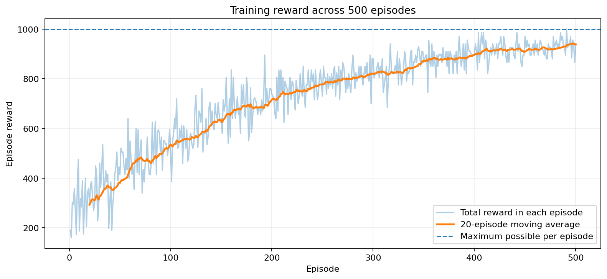
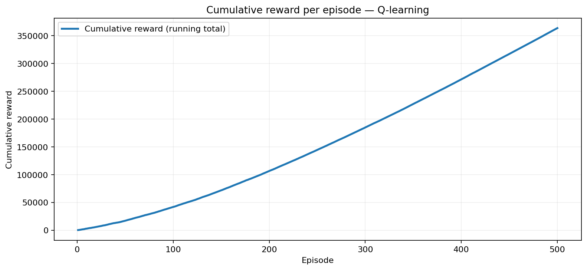

# Assignment 01 — Smart Room Temperature Control Using Q-Learning

A custom Python Reinforcement Learning environment in which a Q-learning agent learns whether the heater should be ON or OFF.

## Assignment configuration

| Item | Setting |
| --- | --- |
| States | Cold (15°C), Comfortable (20°C), Hot (25°C) |
| Actions | Heater ON, Heater OFF |
| Initial state | Cold (15°C) |
| Rewards | +10: Comfortable, −5: Hot, −1: Cold |
| Learning rate | α = 0.1 |
| Discount factor | γ = 0.9 |
| Training | 500 episodes with epsilon-greedy action selection |

The environment is implemented using Python functions, without Gymnasium. The training uses 100 steps per episode with epsilon decay; these are implementation choices, not explicitly prescribed values in the assignment.

## Files

- `smart_room_temperature_control_q_learning.ipynb` — Main Notebook with explanations, outputs, calculation, and charts.
- `smart_room_temperature_control_q_learning.py` — Standalone Python implementation.
- `reward_per_episode.png` — Total reward for each episode with a moving average.
- `cumulative_reward_per_episode.png` — Running cumulative training reward over 500 episodes.
- `requirements.txt` — Required Python packages.

## How to run

```bash
python -m pip install -r requirements.txt
python smart_room_temperature_control_q_learning.py
```

Alternatively, open the notebook in Jupyter, VS Code, or Google Colab and select **Run All**. Running from this folder saves the PNG charts in the same location.

## Learned policy

| State | Learned heater action |
| --- | --- |
| Cold (15°C) | ON |
| Comfortable (20°C) | OFF |
| Hot (25°C) | OFF |

With random seed 42, the reference run recorded an average episode reward of **417.81** for the first 100 episodes and **922.01** for the last 100. The decreasing epsilon reduces exploration and contributes to this difference; it does not alone establish that all Q-values fully converged.

## Training charts





## Required tasks covered

The notebook demonstrates the eight tasks: custom environment; states/actions/transitions/rewards; zero-initialized Q-table; epsilon-greedy Q-learning; 500 training episodes; final Q-table and learned policy; a numerical Bellman update by hand; and a cumulative reward chart with a discussion of performance.

This is a simplified deterministic model, not a physical thermostat.


## Interactive Streamlit GUI

An interactive visualization of the Smart Room Temperature
Control project using Q-Learning.

### Features
- Live room temperature simulation
- Heater ON/OFF control
- Q-Learning training with epsilon decay
- Live Q-table visualization
- Reward graphs
- Greedy policy evaluation

### Run the GUI

Install the required libraries:

    python -m pip install -r requirements.txt

Launch the application:

    python -m streamlit run app.py

Open http://localhost:8501 in your browser.

### Training Configuration
- Episodes: 500
- Steps per episode: 100
- Learning rate (alpha): 0.1
- Discount factor (gamma): 0.9
- Initial epsilon: 1.0
- Epsilon decay: 0.995
- Minimum epsilon: 0.01
- Random seed: 42

The GUI uses the Python Q-Learning engine in heater_rl.py.

## Team Members

This project was developed collaboratively as part of our Reinforcement Learning Assignment 1.

**Team Members:**
- Amira Madgy
- Salma Salah
- Zeinab Mahmoud

We worked together on implementing the Q-Learning algorithm, training the agent, and analyzing the results.
